# CamTrap Verify — User Manual

**CamTrap Verify** is a web application that helps ecologists and wildlife researchers review and validate species detections produced by AI classifiers. It accepts data in [CamtrapDP v1.0](https://camtrap-dp.tdwg.org/) format as well as CSV exports from [DeepFaune](https://www.deepfaune.cnrs.fr/) or any other classifier, and guides the expert through a structured, iterative review that minimises the number of images that must be inspected.

---

## Table of Contents

1. [Overview](#1-overview)
2. [Installation](#2-installation)
3. [Getting Started](#3-getting-started)
4. [Welcome Screen](#4-welcome-screen)
5. [Setup Wizard](#5-setup-wizard)
   - [Step 1 — Source](#step-1--source)
     - [Option A — CamtrapDP directory](#option-a--camtrapdp-directory)
     - [Option B — DeepFaune CSV](#option-b--deepfaune-csv)
     - [Option C — Custom CSV](#option-c--custom-csv)
     - [Option D — Trapper instance](#option-d--trapper-instance)
   - [Step 2 — Species](#step-2--species)
   - [Step 3 — Study Period](#step-3--study-period)
   - [Step 4 — Parameters](#step-4--parameters)
6. [Species Index](#6-species-index)
7. [Image Gallery](#7-image-gallery)
   - [Reviewing Detection Events](#reviewing-detection-events)
   - [Fullscreen Lightbox](#fullscreen-lightbox)
   - [Image Controls](#image-controls)
   - [Keyboard Shortcuts](#keyboard-shortcuts)
   - [Saving Decisions](#saving-decisions)
   - [Completed Species](#completed-species)
8. [Results](#8-results)
9. [Scope and Limitations](#9-scope-and-limitations)

---

## 1. Overview

CamTrap Verify helps experts determine whether a species was present at a given location during a study period. To do this, it divides the study period into fixed-length windows called **sampling occasions** (e.g. 5-day blocks). Within each sampling occasion, images from the same camera are grouped into **detection events** — bursts of consecutive frames taken less than N seconds apart. The question the expert answers is therefore always the same: *"Is this species present at this site during this sampling occasion?"*

To minimise the total number of images that need to be inspected, CamTrap Verify works in **rounds**. In each round, for every combination of site × sampling occasion × species, the tool presents the **detection event with the highest detection confidence** that has not yet been reviewed. The expert then decides:

- **Confirming** a detection event closes that cell — the species is considered present at that site during that occasion.
- **Rejecting** a detection event queues the next-best detection event for the following round.

This guarantees that expert effort is always directed where it matters most, without reviewing every single image. The diagram below summarises the process the expert follows:

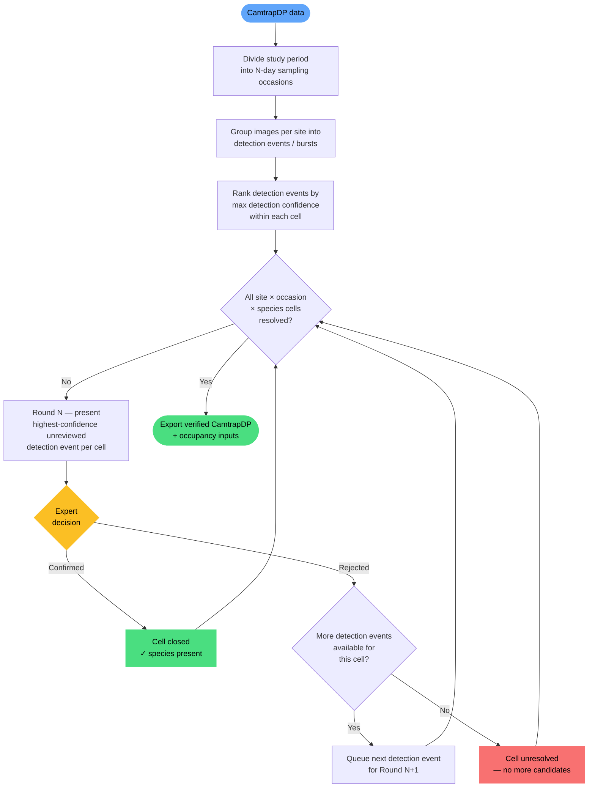

At the end of the review, the tool exports:

- A verified CamtrapDP package (`camtrap_dp_verified/`) with confirmed observations tagged as human classifications.
- Detection histories and camera-operation matrices ready for occupancy models (`occupancy_inputs/`).

---

## 2. Installation

Download the latest release from the [GitHub Releases page](https://github.com/wildintelproject/wildintel-trapverify/releases).

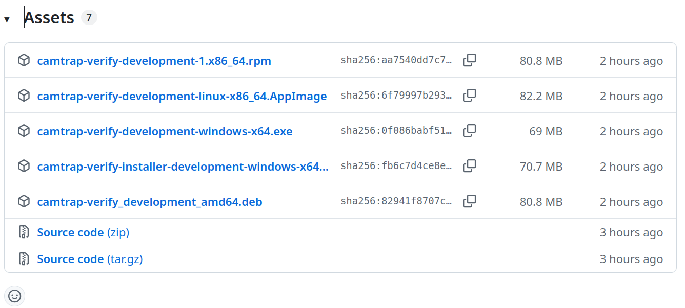
*GitHub Releases page showing the available packages for each platform.*

### Linux

Three options are available depending on your distribution:

**Option 1 — AppImage (any distribution)**

The AppImage is a self-contained executable that runs on any Linux distribution without installation.

```bash
chmod +x camtrap-verify-X.Y.Z-linux-x86_64.AppImage
./camtrap-verify-X.Y.Z-linux-x86_64.AppImage
```

> **Note:** Some distributions require `libfuse2` to run AppImages. Install it with `sudo apt install libfuse2` (Debian/Ubuntu) or `sudo dnf install fuse-libs` (Fedora/RHEL) if you see a FUSE-related error.

**Option 2 — .deb package (Debian / Ubuntu)**

```bash
sudo apt install ./camtrap-verify_X.Y.Z_amd64.deb
camtrap-verify
```

**Option 3 — .rpm package (Fedora / RHEL)**

```bash
sudo dnf localinstall camtrap-verify-X.Y.Z.x86_64.rpm
camtrap-verify
```

### Windows

Two options are available:

- **Portable executable** (`camtrap-verify-X.Y.Z-windows-x64.exe`) — download, double-click and run. No installation required, no administrator rights needed.
- **Installer** (`camtrap-verify-installer-X.Y.Z-windows-x64.exe`) — installs the application with a Start Menu shortcut and an uninstaller entry in *Add or Remove Programs*. Also runs without administrator rights.

Once launched, the application opens automatically in your default browser.

### macOS

Download `camtrap-verify-X.Y.Z-macos-arm64.dmg` from the [releases page](https://github.com/wildintelproject/wildintel-trapverify/releases), open it and drag `camtrap-verify` to wherever you want to keep it (e.g. `/Applications`). Then double-click `camtrap-verify` to launch it.

> **⚠️ macOS security warning:** Since this build isn't signed with a paid Apple Developer certificate, macOS Gatekeeper will block the first launch attempt and may describe it as software that "could harm your Mac" — this is expected for any unsigned, independently distributed app, not a sign that the file is actually malicious. To open it anyway:
>
> 1. Double-click `camtrap-verify` once. macOS will show a warning and refuse to open it — that's normal, click **Done**.
> 2. Open **System Settings → Privacy & Security**.
> 3. Scroll down to the *Security* section, where you'll see a message about `camtrap-verify` being blocked, and click **Open Anyway**.
> 4. Confirm by clicking **Open Anyway** again when the app tries to launch.
>
> You only need to do this once — after that, the app opens normally.

The build targets Intel (x86_64) and runs on Apple Silicon Macs via Rosetta 2.

---

## 3. Getting Started

Open your browser and navigate to the application URL (default: `http://localhost:8765` for the desktop app, or the address provided by your administrator).

> **Tip:** The application works entirely in your browser. Your data never leaves your machine.

---

## 4. Welcome Screen

When you open the application, you will see the **Welcome Screen**. Which buttons appear depends on your session state, not a fixed set of three:

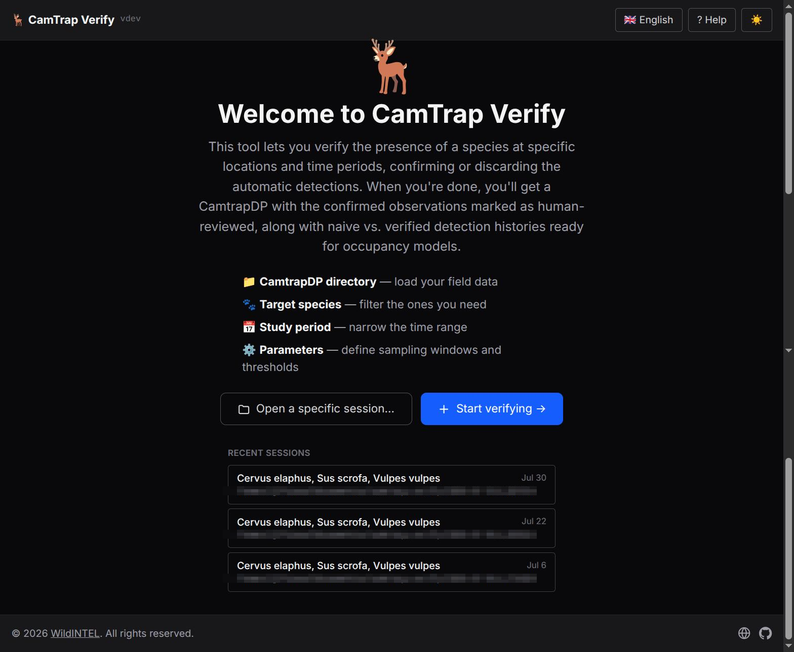
*The Welcome Screen. The exact buttons shown depend on whether a session is currently active and whether you have session history.*

| Button | When it appears | Description |
|---|---|---|
| **Continue previous session →** | Only if a session is currently active | Resumes the session you were last working on. Shows a progress summary below the button (e.g. *3 species · 12/40 occasions reviewed · 30%*). |
| **Open a specific session…** | Always | Opens a file browser so you can load any existing session folder. |
| **Start verifying →** / **New session** | Always — the label depends on state | Starts the Setup Wizard to configure a session. Reads **Start verifying →** if no session is currently active, or **New session** if one is (to start a fresh one alongside it). |

Below the buttons, a **Recent sessions** list appears if you have previously opened sessions on record, letting you jump back into any of them directly — independently of whether a session is active right now.

---

## 5. Setup Wizard

The Setup Wizard guides you through four steps. A step indicator at the top shows your progress.

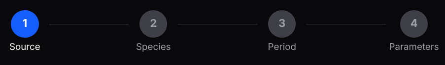
*Step indicator showing the four stages: Source · Species · Period · Parameters.*

You can navigate between steps using the **← Back** and **Next →** buttons, or return to the Welcome Screen with **← Welcome**.

### Step 1 — Source

CamTrap Verify requires you to specify where the information to be verified (images, annotations, deployments, etc.) is located. Although the data is always processed internally in CamtrapDP format, CamTrap Verify supports the following input sources: [CamtrapDP](#option-a--camtrapdp-directory), [DeepFaune](#option-b--deepfaune-csv), [custom CSV](#option-c--custom-csv), and [Trapper](#option-d--trapper-instance).

> **Note:** CamTrap Verify provides a dynamic mechanism for resolving where each image is physically located. This mechanism is based on whether you provide a directory where the images are locally stored.
>
> If you do indicate it, the resolution procedure is the following. CamTrap Verify tries these places in order and uses the first that has the photo:
>
> 1. `Images directory/deploymentID/fileName`.
> 2. **The end of `filePath`** under the Images directory. This finds photos whose `filePath` points at another computer: a `media.csv` exported on a Mac with `/Volumes/Disk/2023/R0025/dep_0011/x.jpg` works on Windows if the Images directory is the folder that holds `R0025/`. Both `/` and `\` are accepted.
> 3. **A folder named like the `deploymentID`**, anywhere up to three levels below the Images directory (for example `Images directory/R0025/dep_0011/`), with the file matched ignoring upper and lower case and equivalent extensions (`x.JPEG` is found as `x.jpg`). This is the usual layout of Trapper exports, whose `filePath` is a web address. A photo found in two such folders is ambiguous and is not used.
> 4. If **Search subfolders by file name**{: #search-subfolders-by-file-name } is enabled, a recursive search of the whole Images directory for a file with that name (useful when photos are all loose in one folder), also ignoring equivalent extensions.
> 5. The end of `filePath` under the **data directory** and under the **parent of the Images directory**, so choosing the wrong level (for example the `camtrapDP` folder itself) does not hide every photo.
> 6. Finally the `filePath` column in `media.csv` itself: absolute paths are used as-is, relative paths are resolved against the Images directory, and remote `http://`/`https://` URLs are fetched directly, through the application's built-in proxy (so no CORS configuration is needed on your end) — but only as a last resort, after the local lookups above have already failed.
>
> If you do not indicate it, there is no separate images root to look in first, so resolution relies on the `filePath` column: absolute paths are used as-is and relative paths are resolved against the CamtrapDP directory itself. If the file is not there, the end of `filePath` is tried under the data directory too, so photos stored below it are found. Remote URLs are always fetched over the network, since there is nowhere local left to check.

First choose where your data comes from: **Local filesystem** or a **Trapper instance**.

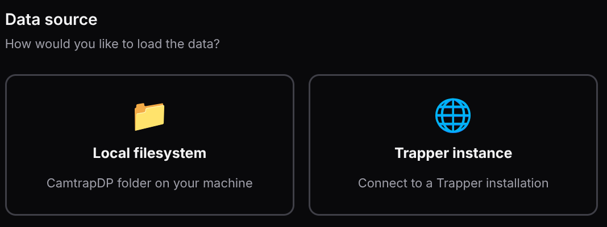
*Data source selector.*

If you select **Local filesystem**, a second selector appears asking for the **data format**. Three formats are supported:

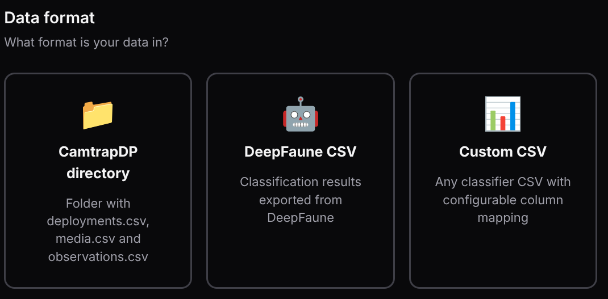
*Format selector: CamtrapDP directory, DeepFaune CSV or Custom CSV.*

#### Option A — CamtrapDP directory

Select the folder on your machine that contains the CamtrapDP files (`deployments.csv`, `media.csv`, `observations.csv`).

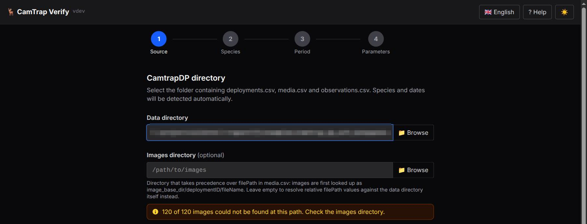
*Local directory selection. The Browse button opens a folder picker.*

- **Data directory** — path to your CamtrapDP folder. Use the **📁 Browse** button or type the path manually.
- **Images directory** *(optional)* — base directory used to resolve relative `filePath` values in `media.csv`. Leave empty to use the data directory itself (default behaviour). Filling it in enables the [**Search subfolders by file name**](#search-subfolders-by-file-name) option (see above).

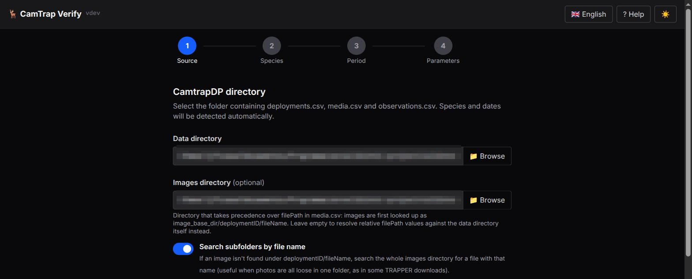
*With an Images directory set, the **Search subfolders by file name** toggle appears.*

After selecting the folder, the application reads species and date ranges automatically. Click **Next →** to proceed.

#### Option B — DeepFaune CSV

If your data comes from [DeepFaune](https://www.deepfaune.cnrs.fr/), select the **DeepFaune CSV** format. The application converts the file to CamtrapDP format automatically. For this reason, the form only asks for a single field, **DeepFaune results file**, where you provide the path to the `.csv` file exported from DeepFaune.

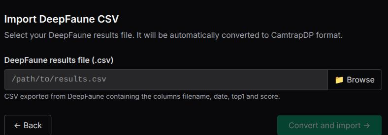
*DeepFaune import form.*

Once you have indicated the path, click **Convert and import →**. Once the conversion is complete, the wizard drops you into the same **Data directory** / **Images directory** screen as Option A above, with **Data directory** already filled in with the converted CamtrapDP folder — fill in **Images directory** there if the paths in your DeepFaune CSV are relative.

#### Option C — Custom CSV

For any other classifier that exports a CSV, choose the **Custom CSV** format. You map the columns of your file to the fields required by CamtrapDP. For this reason, the form first asks for a single field, **CSV file**, where you provide the path to your classifier's `.csv` export.

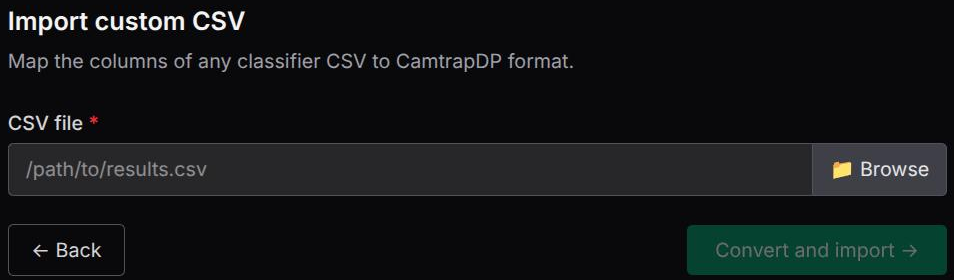
*Custom CSV import form.*

**Column mapping**

Once the CSV file is selected, the application reads its headers and displays a mapping form where you link each column in your file to the fields required by CamtrapDP.

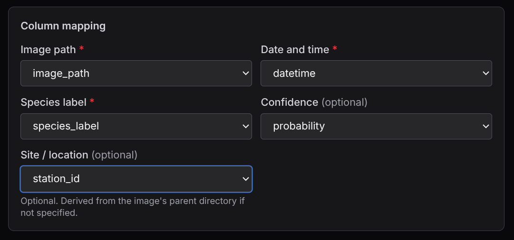
*Column mapping form. Each dropdown is populated with the column names detected in your CSV.*

Select which column in your CSV corresponds to each required field:

| Field | Required | Description |
|---|---|---|
| **Image path** | Yes | Column containing the file path or name of each image. |
| **Date and time** | Yes | Column containing the capture timestamp. |
| **Species label** | Yes | Column containing the classifier's species label. |
| **Confidence** | No | Column containing the detection score (0–1). |
| **Site / location** | No | Column identifying the camera site. Derived from the image path if omitted. |

As soon as you select the **Species label** column, the application reads all unique labels and displays the **Species map** table.

**Species map**

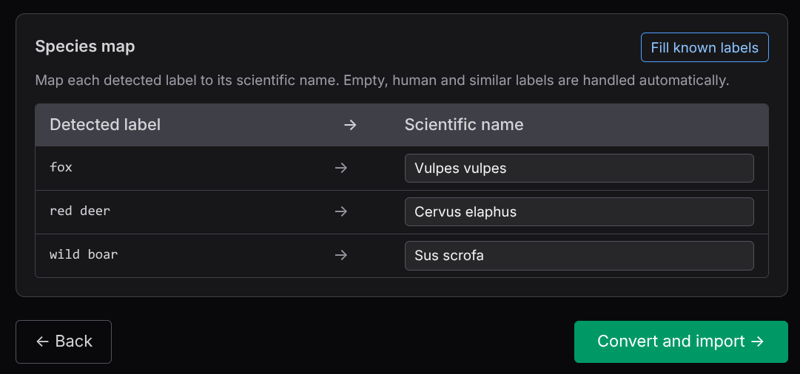
*Species map table. Each detected label must be mapped to a scientific name.*

For each label in your CSV, enter the corresponding scientific name (e.g. `Vulpes vulpes`). Labels that match known DeepFaune classes are pre-filled automatically. Non-animal labels (`empty`, `blank`, `human`, etc.) are handled automatically and do not appear in the table.

Use **Fill known labels** to auto-fill any remaining entries that match the built-in label dictionary.

Once you have mapped the columns and the species, click **Convert and import →**. Once the conversion is complete, the wizard drops you into the same **Data directory** / **Images directory** screen as Option A above, with **Data directory** already filled in with the converted CamtrapDP folder — fill in **Images directory** there if the paths in your CSV are relative.

#### Option D — Trapper instance

Connect to a [Trapper](https://trapper-project.readthedocs.io/) installation to download a CamtrapDP package directly from the platform.

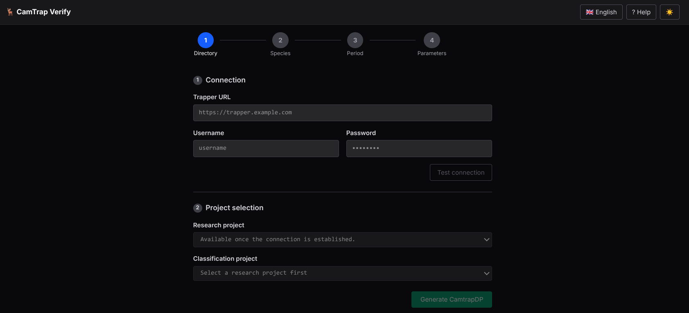
*Trapper connection form.*

1. Enter the **Trapper URL**, **username** and **password**, then click **Test connection**.
2. Once connected, select the **Research project** and the **Classification project**.
3. Click **Generate CamtrapDP** — the package is downloaded and loaded automatically.

> **Note:** Trapper integration is currently under active development. Some features may not yet be available.

### Step 2 — Species

Choose which species you want to verify. The list is populated from the `scientificName` column in `observations.csv`.

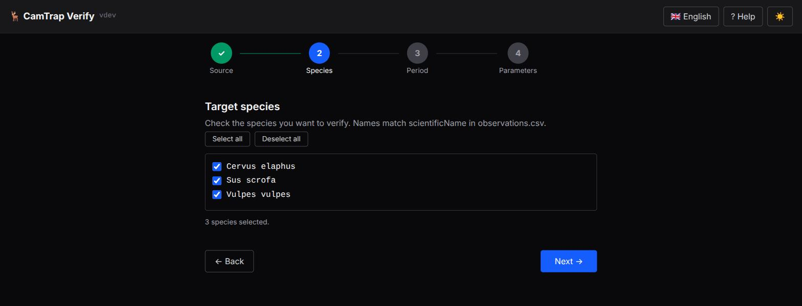
*Species selection step. Check the species you want to review.*

- Use **Select all** / **Deselect all** for bulk actions.
- The counter at the bottom shows how many species are currently selected.

### Step 3 — Study Period

Set the date range for the review. Only images whose timestamp falls within this range will be included.

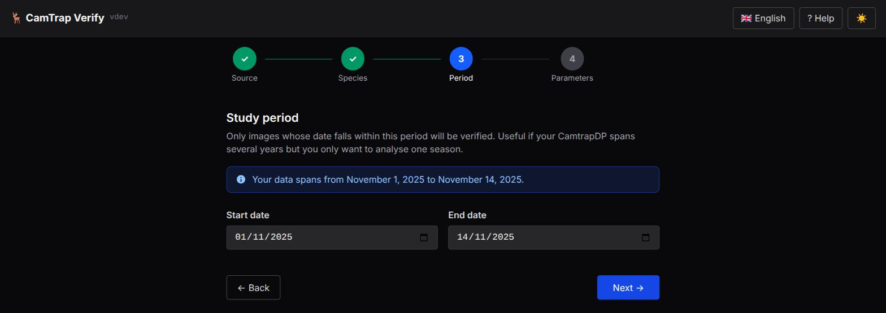
*Study period step. The data range hint shows the earliest and latest dates in your dataset.*

- An info hint shows the full date span available in your data.
- Useful when your CamtrapDP spans multiple years but you only want to analyse one season.

### Step 4 — Parameters

Fine-tune how images are grouped and how confirmations are recorded. Parameters are divided into two sections.

#### Sampling parameters

These control how the data is segmented into reviewable units.

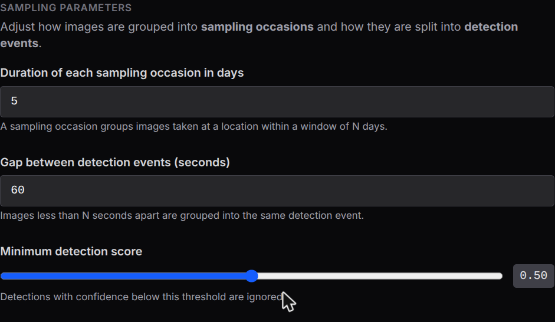
*Sampling parameters section.*

| Parameter | Default | Description |
|---|---|---|
| **Sampling occasion duration** (days or hours) | 5 days | Groups images at a location into consecutive windows of N days, or of N **hours** if you choose *Hours* (for example 1 hour, for activity patterns). The windows start at 00:00 of the first day of the study; the last one is shorter if the study period is not a multiple of the window. The number of occasions adapts automatically to the study duration. See [Occasions shorter than a day](#occasions-shorter-than-a-day). |
| **Gap between detection events (seconds)** | 60 | Images less than N seconds apart at the same site belong to the same detection event. |
| **Minimum detection score** | 0.5 | Detections scoring **below** this threshold are excluded from the candidate set (a score equal to the threshold is kept, and a photo with no score is never excluded). See [When to use a minimum score](#when-to-use-a-minimum-score). |
| **Minimum detection confidence per species** | none | Optional. Under the general score, a collapsible list gives each selected species a box for its own cut-off, which replaces the general one for that species. An empty box uses the general score and `0` turns the cut-off off for that species. See [When to use a minimum score](#when-to-use-a-minimum-score). |
| **Random seed for tied detection events** | 42 | Detection events with the same score in a cell (all of them when the photos have no score) are shown in a pseudo-random order, not by date. The seed makes that order reproducible: the same data and seed always give the same order. It is stored in `config.json`; record it when you report your results. |
| **Session name** | empty | Optional name to tell sessions apart (for example two sessions with the same species). It is shown in **Recent sessions** and at the top of the species index, and it can be changed later with **✎**. See [Naming a session](#naming-a-session). |

#### When to use a minimum score

The cut-off trades completeness for effort. Photos below it are **never shown to the reviewer**, so a true detection scored lower than the cut-off cannot be found or recovered, and the effort savings and the verified results hold **only for candidates at or above the cut-off**.

- **Use a cut-off** when the classifier produces many very low-confidence labels that are almost always wrong, and the species is well recognised by the model (so true detections rarely score low).
- **Avoid it, or set it to 0**, for species the classifier handles poorly (for example nocturnal or partly visible animals), because their true detections are the ones most likely to fall below the cut-off. Low-confidence labels are exactly the images most worth checking.

You do not have to choose one value for everything: **a cut-off per species** lets you keep a cut-off for the species the classifier recognises well and lower it, or turn it off with `0`, for the ones it handles poorly. A species whose own cut-off is above all its scores is left with nothing to review; it does not appear in the species index, but it still appears in the table of excluded photos on Results, with its cut-off.

When a cut-off is active, the Results page shows a notice and a table with, per species, the cut-off that applied to it and the photos and detection events removed and the sampling-occasion cells left with no candidate at all (the same figures are in `effort_report.csv` as `excluded_photos`, `excluded_events` and `excluded_cells`). Report them alongside any claim about effort saved.

#### Confirmation parameters

These control what is recorded in the output when an expert confirms a detection event.

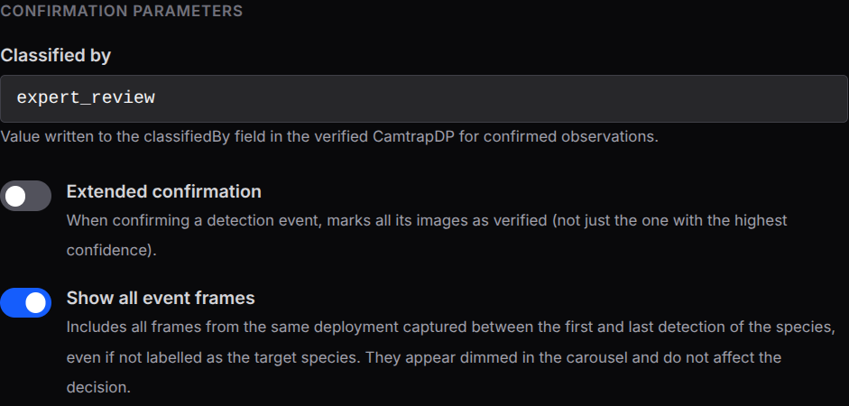
*Confirmation parameters section.*

| Parameter | Default | Description |
|---|---|---|
| **Classified by** | `expert_review` | Value written to the `classifiedBy` field in the verified CamtrapDP for every confirmed observation. Change this to identify the reviewer (e.g. `ornithologist_A`). |
| **Extended confirmation** | Off | When enabled, all observations in the confirmed burst — not just the highest-confidence frame — are marked as human-verified in the output. |
| **Record the actual species when rejecting** | Off | Adds an optional field to rejected detection events to type what the animal really is. It never changes the verification. See [Recording the actual species](#recording-the-actual-species-of-rejected-events). |
| **Idle threshold for review time** | 120 s | A pause longer than this between two decisions is a break and is not counted as review time. See [Review time](#review-time). |
| **Show all event frames** | Off | When enabled, all frames from the same deployment captured between the first and last detection of the target species are shown in the carousel, even if they are not labelled as that species. This lets you see the full context of the animal's visit. Context frames appear dimmed and do not affect the decision. |

Click **✓ Start verification** to process the data and begin the review.

---

### Naming a session

A session can have a **name** so you can tell it apart from others, for example two sessions with the same species but different study periods. Type it in the *Session name* field of the setup parameters (optional, up to 120 characters), or add or change it at any time:

- On the welcome screen, under **Recent sessions**, press **✎** next to a session, type the name and press Enter (Escape cancels).
- On the species index, press **✎** next to the name at the top.

An empty name removes it. In **Recent sessions** the name is shown in bold with the species below it; a session without a name shows its species as before. The name is stored in the session's `config.json` as `session_name`, so it stays with the session. Sessions made before names existed have none and work as before.

### Continuing a session on another computer

To move a session, open it on the species index and press **Export session**: your browser downloads a ZIP with your decisions and settings (no photos and no results files, so it is small). On the other computer, press **Import session…** on the welcome screen and choose the ZIP; it opens as a new session in the default output folder.

The photos and the CamtrapDP are not in the ZIP, so the app must find them on the new computer. If it cannot, a **Fix links** notice appears (also after moving the data on the same computer): choose the CamtrapDP folder and, if needed, the photos folder. The folder must hold the same dataset (same `deployments.csv`) or the app refuses it. If you already used that dataset on this computer, the folders are found automatically. The results files are regenerated from your decisions.

## 6. Species Index

After setup (or when resuming a session), you arrive at the **Species Index** — an overview of all target species and their review progress.

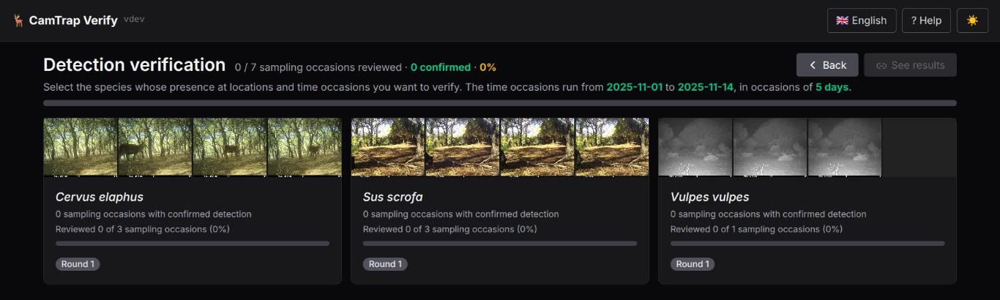
*Species index showing species cards with progress bars.*

An information panel at the top shows the session parameters:

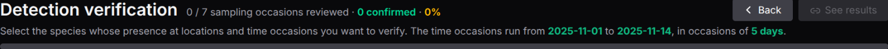
*Info panel showing overall progress, the study period and the sampling occasion length.*

- **Overall progress** — how many sampling occasions have been reviewed out of the total, how many are confirmed, and the percentage complete.
- **Study period and sampling occasion length** — the date range being reviewed and the N-day (or N-hour) window each sampling occasion spans.
- **← Back** — return to the Welcome Screen.
- **See results** — navigate to the Results page (only active when all species are complete).

Each **species card** displays:

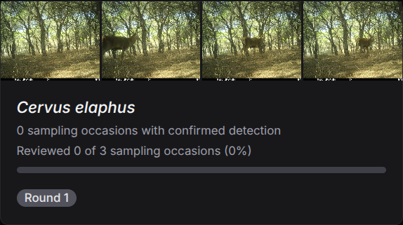
*A species card showing thumbnail strip, progress bar and round badge.*

- A thumbnail strip with representative images.
- The number of sampling occasions with confirmed detections.
- A progress bar and percentage of reviewed occasions.
- A badge: **Complete** (green) or **Round N** (grey) indicating the current review round.

Click any card to open the Image Gallery for that species.

---

## 7. Image Gallery

The Image Gallery is the main review screen. It shows all sampling occasions for a single species, grouped by location.

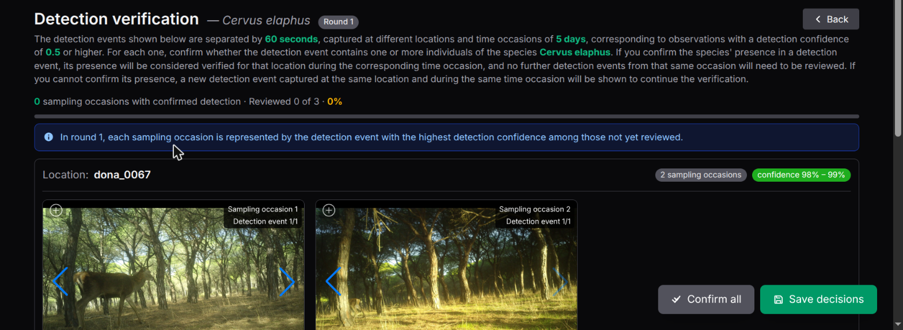
*Gallery showing sampling occasion cards grouped by site.*

The header shows:
- The species name and current round badge.
- Overall progress (occasions reviewed / total).
- A **← Back** button to return to the Species Index.

A blue info box below the header explains the round logic:

> *In round N, each sampling occasion is represented by the detection event with the highest detection confidence among those not yet reviewed.*

### Reviewing Detection Events

Each **sampling occasion card** shows:

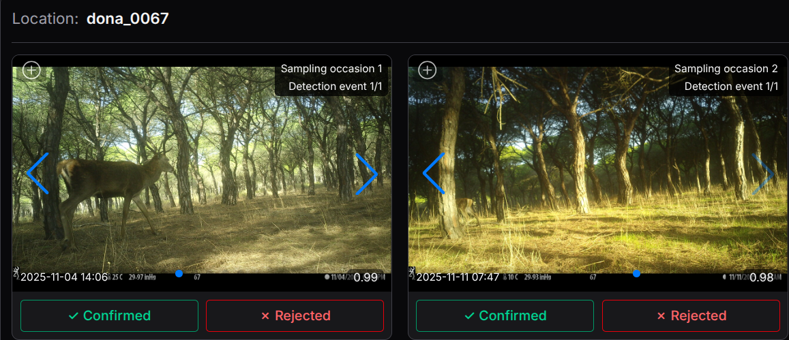
*A sampling occasion card with image carousel and decision buttons.*

- Location and occasion number.
- Confidence range of the detection events in this occasion.
- A carousel of the images in the current detection event, with left/right arrows to browse frames.
- Two decision buttons: **✓ Confirmed** and **✗ Rejected**.

If **Show all event frames** is enabled, all frames from the same deployment captured between the first and last detection of the target species are shown in the carousel, including those not labelled as that species. These frames appear dimmed and do not affect the decision.

Click any image to open the [Fullscreen Lightbox](#fullscreen-lightbox).

### Fullscreen Lightbox

Click any image thumbnail to open the lightbox for a closer look.

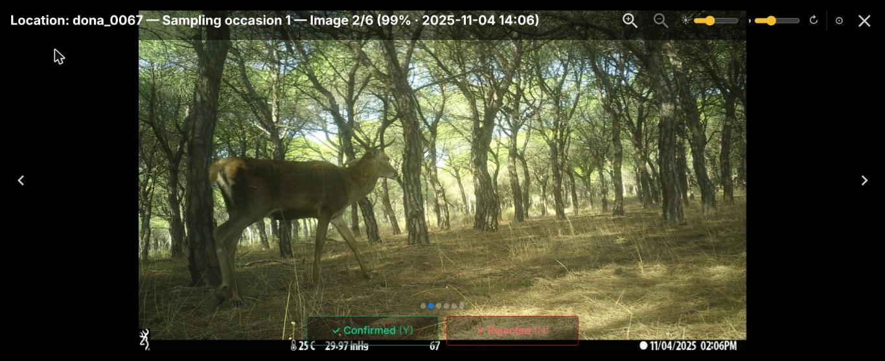
*Fullscreen lightbox with image controls and decision buttons.*

The lightbox shows:
- The full-size image with zoom and pan support.
- Navigation arrows to browse frames within the detection event.
- The location and sampling occasion in the title bar.
- A **panel on the left** (on screens at least 900 px wide) with the review progress and the decision buttons, stacked vertically so they are close to the photo. The progress shows the round, how many cards are decided in the round (with a bar), how many at the current location, and how many occasions of the species were resolved before the round. On narrower screens the panel is replaced by a one-line progress and the buttons in a strip at the bottom.
- **↶ Previous card** (also `Backspace`): goes back to the card you decided just before, through every card decided since the lightbox was opened, so you can correct a mistake. The card shows the decision it had and nothing is undone until you press a different decision.
- The image adjustment controls in the toolbar.

The **Large view** button in the header opens the lightbox at the first undecided card (or at the first card when you are reviewing a finished species), without having to click a photo.

### Image Controls

The lightbox toolbar provides several controls to improve image visibility:

| Control | Description |
|---|---|
| ☀ **Brightness** | Slider to increase or decrease brightness (50 – 200 %). |
| ◑ **Contrast** | Slider to increase or decrease contrast (50 – 200 %). |
| ↻ **Rotate 90°** | Rotate the image clockwise in 90° steps. |
| ⊘ **Reset image** | Restore brightness, contrast and rotation to defaults. |
| **Invert colours** | Toggle colour inversion — useful for night-vision images. |

All adjustments reset automatically when you move to a different detection event or close the lightbox.

### Keyboard Shortcuts

While the lightbox is open:

| Key | Action |
|---|---|
| `Y` | Confirm the current detection event |
| `N` | Reject the current detection event |
| `U` | Mark the current detection event as **Uncertain** (counts as rejected) |
| `Backspace` | Go back to the card decided just before (**Previous card**) |
| `↑` `↓` | Previous / next card at the same location |
| `←` `→` | Navigate between frames in the detection event |
| `Esc` | Close the lightbox |

After a decision, the lightbox automatically advances to the next undecided detection event.

### Uncertain cases

Sometimes the assigned label is possible but you cannot be sure, for example an animal that is only partly visible or moving quickly through a dark frame. The tool gives no third answer to occupancy, so the recommended rule is: **if you cannot confirm the species with reasonable confidence, do not confirm it**.

Use **Uncertain** (button on the card, or `U` in the lightbox) for these cases. For the analysis an uncertain detection event behaves **exactly like a rejection**: it never confirms a sampling occasion, the next-best detection event of that occasion is shown in the following round, and the detection histories are identical to those obtained by rejecting it. The reason is that a possible error is then absorbed by the detection probability *p* of the occupancy model, which is safer than counting a doubtful record as a detection.

The difference is that uncertain events are **recorded and counted**: the Results page and `effort_report.csv` give, per species, the number of `uncertain_events` and the non-detection cells that contain at least one (`non_detection_cells_with_uncertain`). A large share of uncertain events for a species is a sign that it is hard to verify from the photos, or that the occupancy estimate for it deserves extra care. Uncertain decisions are stored in `uncertain_<species>_iter<N>.csv` next to the decision files, are restored when you reopen a round, and do not change any other output. An event that is later confirmed is no longer counted as uncertain.

### Recording the actual species of rejected events

Rejecting a detection event only says that the label is wrong. When an event is rejected you may also want to note what it really was (for example, a fallow deer labelled as red deer, or a person labelled as a dog), because that tells you where the classifier makes its mistakes. Turn on **Record the actual species when rejecting** in the setup (it is off by default, so the review stays as fast as before).

With the option on, a rejected card shows an optional field *Actual species*. Start typing to get suggestions from the taxa found in your dataset, plus *Homo sapiens* and *No animal / empty*, or type any name. The same field appears in the large view below the decision buttons. The field is optional and the keyboard shortcuts are unchanged: `N` rejects without opening anything.

This **never changes the verification**: a rejection is still a rejection, the next detection event is still shown in the following round, and the detection histories are identical with the option on or off. In particular, a rejected event relabelled as another species is **not** counted as a detection of that species; recording it only keeps the information the reviewer already had.

The values are saved in `rejection_corrections.csv` in the session folder. From them the Results page and `occupancy_inputs/false_positive_sources.csv` show, per species, the main sources of false positives: the actual species, the number of rejected events and their share of all the rejected events of that species. A row *not recorded* collects the rejected events with no actual species typed, so the shares add up to 100 % and you can see how complete the record is.

### Bounding boxes

When the data say where the animal is in the photo, the review **draws a box around the animal being verified**, on the cards and in the large view. This matters when a photo contains several animals or labels: the box shows which one you are asked about.

- The **amber** box with a dark outline is the box of the species you are reviewing (the one the classifier is most confident about). If the photo has other boxes of the **same species** (several animals), they are drawn thinner and lighter. Boxes of **other species** in the same photo are not drawn: the same photo shows a different box in the review of each species.
- The box is part of the picture that is shown, so it stays in place when you zoom, rotate, invert or enlarge the photo.
- Use the **Show boxes** checkbox at the top of the gallery to hide or show them (it appears only when the data have boxes, and the choice is remembered). The files on disk are never changed.
- If a photo has **no box**, nothing is drawn. Photos that the app loads from a remote server (for example some Trapper links) are shown without boxes.

Where the boxes come from: the CamtrapDP columns `bboxX`, `bboxY`, `bboxWidth` and `bboxHeight` of `observations.csv`, which give the top-left corner and the size of the box as **fractions of the image width and height (0 to 1)**. They are read from a CamtrapDP folder and from a *Custom CSV* that has columns with those same names. The DeepFaune CSV format has no boxes, so photos imported from it are shown without them. Boxes that are missing, not numbers, empty or outside the image are ignored.

### Review time

The app records **when** each decision is made, in `review_log.csv` in the session folder (one row per detection event: its decision, `confirmed`, `rejected` or `uncertain`, and a UTC timestamp), so the effort can be reported in hours and not only in photos or events. The timestamp is taken when you click; if you change a decision before saving the round, the time of the last change is kept.

The **active review time** is computed from the time between consecutive decisions, over the whole session and all species:

- Each decision is credited with the time since the previous decision **if that gap is at most the idle threshold** (120 s by default, set in the setup under *Idle threshold for review time*). A longer gap is a break and counts as zero.
- The time before the first decision of each work block cannot be observed, so the result is a slight underestimate (about one decision per block).
- **Confirm all** and other bulk actions produce decisions with almost no time between them, so they add almost no time.

The Results page and `effort_report.csv` (`review_active_seconds`, `review_decisions_timed`, `review_seconds_per_decision`) give the active time per species and in total. They also give an **estimate** of a full event-level review (`review_est_full_seconds` = candidate events × your mean seconds per decision) and of the time saved (`review_est_saved_seconds`). It is an estimate, not a measurement: it assumes the events that were never inspected would have taken as long as the ones you did. Sessions made before this was recorded have no timestamps and show *n/a*.

### Saving Decisions

Once you have reviewed the detection events, click **Finish round** (floating button, bottom-right).

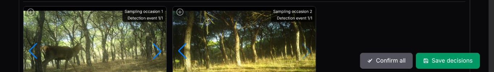
*Floating action buttons: Confirm all, Save progress, Finish round (the screenshot predates the Save progress button).*

- If all detection events have been decided, the session advances to the next round (if any occasions were rejected) or marks the species as **Complete**.
- If some detection events are still undecided, a warning is shown.

The **✓✓ Confirm all** button marks every undecided detection event in the current view as confirmed in one click.

### Saving progress and going back a round

You do not have to finish a round in one sitting. Your decisions (including *Uncertain* flags and any typed *actual species*) are **saved automatically** in the session folder a couple of seconds after each click, when you press **Save progress**, and when you close the page. The button shows when the last save happened. Open the species again, from any browser, and the round comes back as you left it; the progress also travels with the session when you export it (see *Continuing a session on another computer*). Progress is stored in `decisions/progress_<species>_iter<N>.csv` and **changes no result** until you press **Finish round**, which removes it.

If you notice a mistake in a round that is already finished, press **← Back to round N** next to the round badge. That round is reopened with its decisions (flags, actual species and times included) so you can correct them; until you finish it again nothing from it counts. Finishing it again writes the same files as deciding it once. The round's old files are kept as a backup in `decisions/reopened/`, and your progress in the later round is kept. This is not available once the species' decisions were edited as a whole with the lock button (🔒) on a completed species.

### Completed Species

When all occasions for a species have been decided, the gallery shows a **Complete** badge and locks the view.

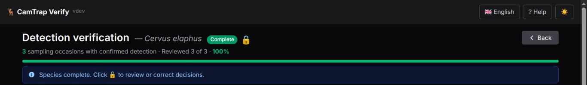
*Completed species with the lock icon and edit mode toggle.*

- Click 🔓 to enter **edit mode** and correct any decisions.
- In edit mode, click **Update decisions** to save and regenerate the results.
- Click 🔒 to lock the view again.

---

## 8. Results

Once all species are complete, the **See results** button in the Species Index header becomes active.

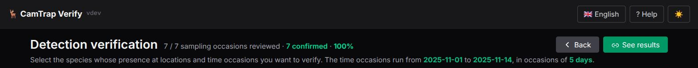
*The "See results" button turns green when all species have been reviewed.*

Click it to open the **Results** page, which summarises the entire review.

The page first shows the **output directory**:

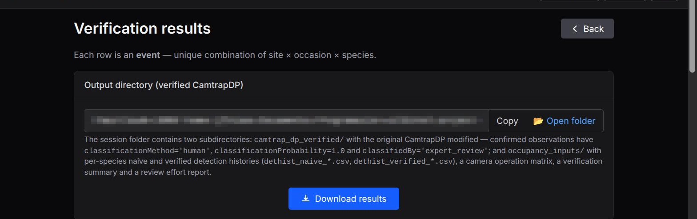
*Output directory, with copy/open-folder buttons and the Download results button.*

This is the path to the generated files (see [Output Files](#output-files) below for what's inside), with a copy button, a shortcut to open the folder, and a **Download results** button to get a `.zip` of the whole session folder. If the exported package's `datapackage.json` had to be auto-generated (the source had none), a warning is shown here listing which fields are placeholders rather than derived from your data.

Next comes the **review breakdown**:

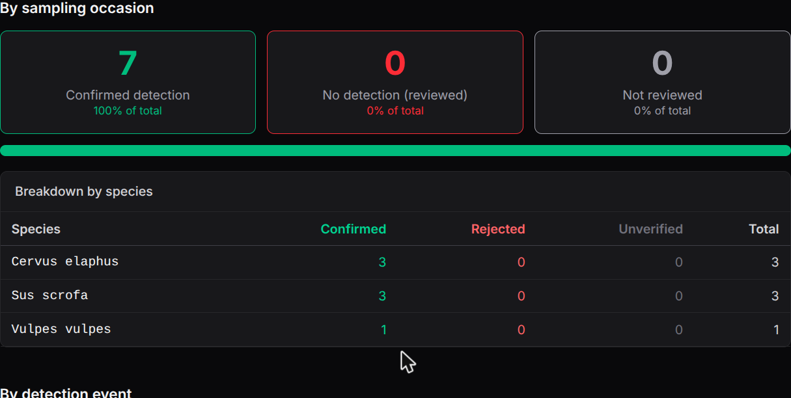
*"By sampling occasion" breakdown, with overall counts and a per-species table.*

This is repeated twice — **by sampling occasion** and **by detection event** — each with confirmed / rejected / unreviewed counts and percentages, followed by a per-species breakdown table.

Finally, when enough detection history is available, the page shows an **occupancy estimate**:

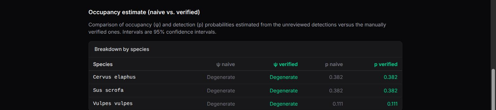
*Naive AI-only occupancy (ψ) and detection (p) probabilities compared against the manually verified ones, per species, with 95% confidence intervals.*

The table has four estimates per species, each with its 95 % confidence interval: **ψ** (occupancy) and **p** (detection), both **naive** (from the AI detections, as if every candidate were a real detection) and **verified** (from the detections you confirmed). Verification changes the detection histories, so it changes *p* as well as ψ. The same four estimates, with their limits, are exported in `occupancy_inputs/occupancy_fit.csv` (`psi_naive`, `psi_naive_lo`, `psi_naive_hi`, `p_naive`, `p_naive_lo`, `p_naive_hi` and the same with `_verified`).

#### How the occupancy estimates are computed

**The model, ψ(.)p(.).** The estimates come from a single-season occupancy model (MacKenzie et al. 2002) with one occupancy probability ψ and one detection probability *p*. The notation ψ(.)p(.) means that each of the two is a single constant value for all sites and sampling occasions: the dot "(.)" stands for "no covariates". In plain words: each site is occupied with probability ψ; if it is occupied, every sampling occasion detects the species with probability *p*, independently; if it is not occupied, it is never detected. Sampling occasions in which the camera was off are left out for that site.

**Estimation.** ψ and *p* are the values that make the observed detection histories most likely (maximum likelihood). The calculation is done on the logit scale, `logit(x) = ln(x / (1 − x))`, which keeps both probabilities between 0 and 1, and is then converted back to probabilities.

**Confidence intervals.** Each 95 % interval is a *Wald interval on the logit scale*: the estimate on the logit scale plus or minus 1.96 times its standard error, converted back to a probability. This is why the intervals are not symmetric around the estimate and never go outside 0–1. The standard error comes from the curvature of the likelihood at its maximum (the inverse of the observed information, computed numerically). It is the same kind of interval as the default `confint()` of the R package `unmarked`; it is *not* a profile-likelihood interval and it does not use the delta method on the probability scale. Wald intervals can be unreliable with few sites or when an estimate is close to 0 or 1.

When the data do not allow a standard error to be computed (the curvature of the likelihood is flat or ill-defined, typical when ψ is estimated at the edge of 0–1), the table shows the estimate **without** an interval rather than inventing one; in `occupancy_fit.csv` the `_lo` and `_hi` cells are then empty.

**"Degenerate" estimates.** When the data cannot support the model, the table shows *Degenerate* instead of a ψ value: when there are no detections at all or only detections, when the fit does not converge, when ψ is essentially 0 or 1, or when the interval for ψ is wider than 0.9. In those cases report the result at the level of detections (confirmed detection events or cells) rather than as an occupancy estimate. The implementation is in `backend/src/occupancy_model.py`.

### Output Files

Each session is saved in a timestamped subfolder inside the output directory (e.g. `~/Documents/camtrap_verify/20260629_143021/`). The folder contains:

**Session files (root)**

| File | Description |
|---|---|
| `config.json` | Session configuration: data directory, date range, parameters. |
| `candidate_manifest.csv` | Full list of candidate detection events generated at setup. |
| `rejected_media.json` | IDs of media files rejected during the review. |
| `decisions/` | Per-species per-round decision CSVs, named `decisions_{species}_iter{N}.csv` (e.g. `decisions_Vulpes_vulpes_iter1.csv`). |

**`camtrap_dp_verified/`** — verified CamtrapDP package

| File | Description |
|---|---|
| `deployments.csv` | Original deployment table (unchanged). |
| `media.csv` | Original media table (unchanged). |
| `observations.csv` | Confirmed observations updated with `classificationMethod='human'`, `classificationProbability=1.0`, `classifiedBy=<configured value>` and `classificationTimestamp`. |

**`occupancy_inputs/`** — ready-to-use files for occupancy models

| File | Description |
|---|---|
| `camera_operation.csv` | Camera operation matrix (sites × sampling occasions): days of operation per occasion, or **hours** of operation when the occasions are in hours. |
| `dethist_naive_{sp}.csv` | Naive detection history per species (AI detections, not human-validated). One file per species. |
| `dethist_verified_{sp}.csv` | Verified detection history per species (confirmed by expert). One file per species. |
| `verification_summary.csv` | Per-species summary: confirmed, rejected and unreviewed counts. |
| `occupancy_fit.csv` | Occupancy fit per species: naive and verified ψ and *p*, each with its 95 % confidence limits (see [How the occupancy estimates are computed](#how-the-occupancy-estimates-are-computed)). |
| `review_effort.csv` | Total review effort: number of detection events and images inspected. |
| `effort_report.csv` | Effort per species and in total, in detection events and cells: cells with and without detection, events inspected in each, rejections before the first confirmation, and the scores of rejected and confirmed events. *Inspecting* an event means viewing its top-scoring photo, so `photos_inspected` equals `events_inspected`; `candidate_events` is the baseline of a full event-level review. |

---

## 9. Scope and Limitations

CamTrap Verify has one job: to help an expert confirm, with as few photos as possible, where a species was really detected, so that the result can be used in an occupancy analysis. It is not a classifier, and it does not remove every source of error. This section says what it assumes and what it does not do.

### It needs a classifier or labelled photos

The tool starts from labels that already exist: the output of an AI classifier, or labels from a citizen-science platform. It does not create them. Where no good classifier exists for the animals or the region, or where photos are hard to classify automatically (for example dense, cluttered vegetation such as tropical forest understorey), there will be fewer correct candidates to find and the benefit will be smaller. The tool works with any source that provides a label and, ideally, a score for each photo, and it can import DeepFaune results, a custom CSV, a CamtrapDP folder or a Trapper project (see [Step 1 — Source](#step-1--source)).

### It works on still images, not on video files

CamTrap Verify reads photos only; it does not open video files, and classifiers that work directly on video are not supported. If you have video, one possible workflow is to **extract still frames from each clip, classify the frames, and then run the tool on them**. We have not tested this on video data, so treat the following as guidance:

- Give each frame a timestamp (the start of the clip plus the frame's position in it). Frames that are less than the *Gap between detection events* apart are grouped into one detection event, so the frames of one clip normally become one event.
- Two different clips that are closer in time than that gap will be merged into one event. Lower the gap if that happens.
- Extracting many frames per second makes every event contain many photos. The number of *photos* reported then says little; use the number of *events* and cells, which do not depend on the frame rate.

Whether the tool will later read video directly depends on how common reliable video classifiers become; there is no plan at the moment.

### Occasions shorter than a day

In the setup you can give the sampling occasion length in **hours** instead of days. The main use is **activity patterns**: with occasions of 1 hour, the review confirms, for every species, location and hour, whether the species was really detected, so the verified detection histories say *when* during the day each species is active.

- The windows start at 00:00 of the first day, so 1-hour occasions are the clock hours (00:00–01:00, 01:00–02:00, ...). The last window is shorter when the study period is not a multiple of the window.
- `camera_operation.csv` then gives the **hours** each camera was working in each window (any operation inside the window counts as one hour, as any operation counts as one day with day occasions). The start and end of each deployment are used to the minute when they include a time; a date without a time covers the whole day. An occasion with the camera off is **NA** in the detection histories, not 0, as with days.
- The **occupancy estimate is not computed**: occupancy and detection probability are not meaningful when the "occasions" are hours of the same day, so Results shows a notice instead of the table. Only the detection histories (`dethist_naive_*.csv`, `dethist_verified_*.csv`) are meant to be used, for activity analyses.
- What the data represent is still *one verified record per species, location and sampling window*: the highest-scoring events of each hour are reviewed until one is confirmed. Use them for **when** a species is active, not for **how many** animals or events there were. As always, an animal that the classifier missed is not recovered (see [Missed detections are not corrected](#missed-detections-are-not-corrected)).
- Sessions made before this option existed only have a number of days and work as before.

### Analyses other than occupancy

The outputs are designed for **occupancy models**: a detection history per species and a camera-operation matrix (see [Output Files](#output-files)). Be careful with other uses:

- **Only one detection event is verified per cell.** The review stops at the first event you confirm, so the verified data do not contain every detection. They cannot be used to count events or animals, because most detections are never looked at. For **daily activity patterns**, use [occasions of one hour](#occasions-shorter-than-a-day), where each hour of each site has its own verified record.
- **Abundance** methods that need every independent event (for example random-encounter models) or that need individuals to be told apart (spatial capture–recapture) are not supported.
- **Time to first detection** needs the *earliest* detection in each period. The tool presents the highest-scoring event first, not the earliest, so a missed first detection is possible, and for this kind of analysis its effect is larger than for presence/absence, because the first detection itself is the measurement.

### What the score needs to be

The score is used only to **order** the detection events within each site and sampling occasion (highest first) and, optionally, for the minimum detection score. It does **not** need to be a calibrated probability: any value where higher means more likely works, including raw model outputs such as logits. Points to keep in mind:

- If your scores are not between 0 and 1 (for example raw logits, which can be negative), set the **Minimum detection score** to 0 to turn the cut-off off; with the default 0.5 every photo below it would be dropped. If the folder has a `datapackage.json`, a (non-blocking) warning that `classificationProbability` is outside 0–1 is also shown when the folder is checked.
- A photo with **no score** is treated as having a score of 0. If some photos have no score, those with a negative score are shown after them.
- If **no photos have a score**, the detection events of each cell are presented in a **random order set by the random seed** (setup parameter, 42 by default), the same order every time for the same data and seed. The same applies to any events that share the same score. The review is still valid, but the first round is no longer the most likely detection, so more photos will usually need to be inspected. Report the seed with your results.
- A cut-off hides the photos below it for good, and the savings and results then apply only to the photos above it (see [When to use a minimum score](#when-to-use-a-minimum-score)).

### Guidance for reviewers

- **Uncertain cases.** If you cannot confirm the species with reasonable confidence, do not confirm it. Mark it **Uncertain** (counted as a rejection, but recorded), as explained in [Uncertain cases](#uncertain-cases).
- **Who reviewed.** The app does not record reviewers. When you report the verification, state how many people reviewed, their expertise with the species in the study area, and whether any photos were checked by a second person. The *Classified by* setting writes a name or team label into the verified data.
- **Double verification.** A session has one reviewer. To check agreement between two people, each reviews the same data in their own session; the decision files (`decisions/`) can then be compared.
- **Species easily confused.** Records of species that look alike (for example red and fallow deer at night) are the likeliest source of reviewer error. Record the actual species of rejected events if you want to quantify the main false-positive sources (see [Recording the actual species of rejected events](#recording-the-actual-species-of-rejected-events)).

### Missed detections are not corrected

Verification removes **false positives**: detections the classifier made wrongly. It does **not** find **false negatives**: animals that were in a photo but that the classifier missed or labelled as another species, because the tool only shows photos the classifier proposed for the species. These missed detections can matter for rare species and in difficult conditions such as night-time photos or dense vegetation, where they lower the true detection probability. Recording the actual species of a rejected event keeps that information but does **not** turn the event into a detection of the other species.

### Photos with several animals or labels

A photo can have labels for more than one species at once (for example when an object detector marks several animals). It appears in the review of each of those species. If the data include **bounding boxes**, the box of the animal being verified is drawn on the photo, so you know which one is meant (see [Bounding boxes](#bounding-boxes)). If they do not, the **whole photo** is shown without a box, and with several animals you have to judge by the species you are reviewing, which is shown at the top of the page.
